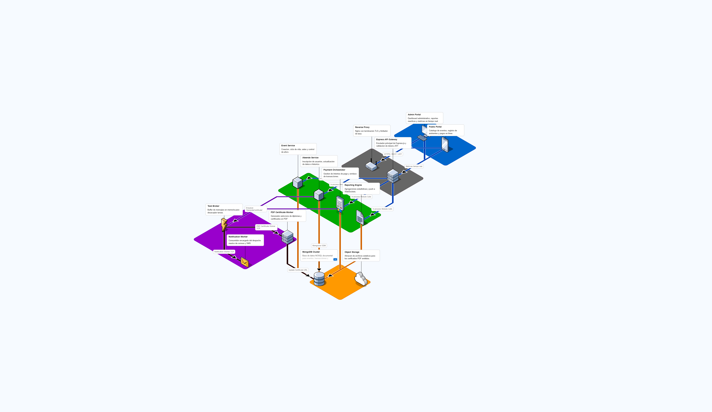
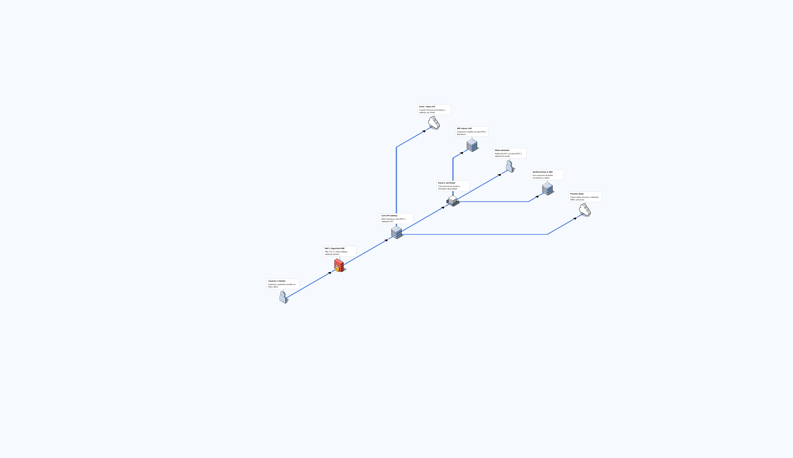

## Diagramas de Arquitectura

Los diagramas de arquitectura presentes fueron creados utilizando el software opensource FossFLOW
### [FossFlow](https://github.com/victortassinari/FossFLOW)

  <table border="0">
    <tr>
      <td align="center"><b>Arquitectura de Aplicaciones</b></td>
      <td align="center"><b>Arquitectura de Integraciones</b></td>
    </tr>
    <tr>
      <td></td>
      <td></td>
    </tr>
  </table>

